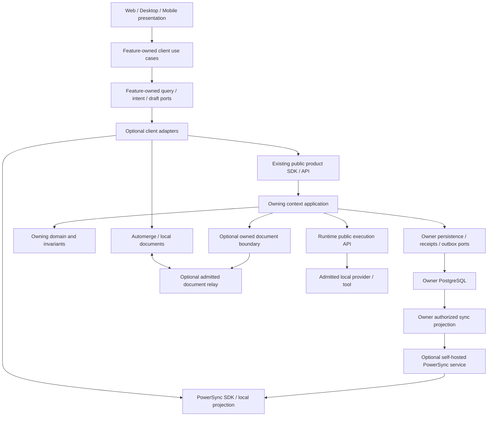

# Offline-first / local-first architecture and synchronization foundation

Status: proposed owner direction and design, 2026-11-27. Documentation only.
This is not an accepted product ADR, immutable FMS/CMS successor, package
admission, implementation authorization, version pin or qualification receipt.
Product owner requested readiness now for backend and frontend, reusable
open-source mechanisms, and independently usable Fully Local products.

## 1. Existing decisions and scope

- [Orchestrator ADR-0048](https://github.com/agent-teams-ai/agent-teams-orchestrator/blob/main/docs/decisions/0048-single-persistence-authority-and-logical-transfer.md)
  establishes one persistence authority per context/profile, explicit logical
  transfer, and separately modeled continuous collaboration (not a repository/UoW feature).
- [ADR-0114](https://github.com/agent-teams-ai/agent-teams-orchestrator/blob/main/docs/decisions/0114-canonical-backend-stack-and-distributed-role-adoption.md)
  explicitly replaces the older local SQLite authority with native PostgreSQL.
  [ADR-0115](https://github.com/agent-teams-ai/agent-teams-orchestrator/blob/main/docs/decisions/0115-canonical-fully-local-v1-adoption.md)
  and [Platform ADR-0010](https://github.com/agent-teams-ai/agent-teams-platform/blob/main/docs/decisions/0010-fully-local-v1-and-shared-backend-profiles.md)
  require Fully Local V1, shared owned application semantics, explicit Target selection,
  independent local authority, and no implicit hosted/local fallback.
- [Runtime v3 foundation](https://github.com/agent-teams-ai/agent-runtime/blob/main/docs/architecture/agent-runtime-greenfield-foundation-plan.md):
  Agent Execution, Provider Access, Runtime Security and Runtime Configuration
  retain ownership. Existing Ordinary Operations, durable claims, receipts,
  custody and generation fencing are not reimplemented. Local storage adoption
  has its existing owner-specific admission route.
- [Identity #1 at reviewed source](https://github.com/agent-teams-ai/identity/blob/deb399260bea43e8486e2b6c2c35efeb659e572e/docs/plans/identity-service-implementation-plan.md)
  and [implementation #2](https://github.com/agent-teams-ai/identity/pull/2):
  Keycloak owns authentication; Identity owns AccountId, bindings and lifecycle;
  products retain local principals, membership, permissions and credentials.
  Neither cloud account nor Identity is a prerequisite for Fully Local.
- Parallel [Evolution-Ready #472](https://github.com/agent-teams-ai/.github/pull/472),
  [Orchestrator #114](https://github.com/agent-teams-ai/agent-teams-orchestrator/pull/114),
  [Runtime #265](https://github.com/agent-teams-ai/agent-runtime/pull/265) and
  [Platform #67](https://github.com/agent-teams-ai/agent-teams-platform/pull/67)
  already delegate detailed sync here. Respect their branches. [Catalog #474](https://github.com/agent-teams-ai/.github/pull/474)
  and [bootstrap #448](https://github.com/agent-teams-ai/.github/pull/448)
  own their separate proposals; do not duplicate or edit their files.
- Follow [organization vision](ecosystem-vision.md), [engineering quality](../engineering-quality-standard.md),
  FMS, applicable Get Modular CMS and existing owner conformance. Legacy
  777genius Desktop is a behavior reference, not an integration target.

Mandatory readiness means deliberate seams when a feature actually owns durable
user data, changes, authority or a client projection. It does not mean a sync
library dependency, event sourcing, CRDT, second database, server or extra
process in every feature. V1 Fully Local remains required under current ADRs;
continuous multi-device collaboration is a separately qualified profile,
not an added V1 release gate. No product code or new repository in this PR.

## 2. Separate four deployment and data profiles

| Profile | Authority and offline guarantee | Sync |
| --- | --- | --- |
| L: Fully Local | One local Target, native backend, PostgreSQL, existing durable workflow and AR; local owner can work without internet with installed local models/tools | None; backup/export remains usable |
| C: Connected client | Hosted or self-hosted Target remains authority; client has durable authorized read model and allowed pending intents; offline UI never claims remote execution | Optional client-server adapter |
| D: Independent installations | Each Target owns its local operations; exchange only explicitly shared documents, artifacts and submitted work under provenance | Optional CRDT/document exchange and owner-specific logical transfer |
| F: Federated collaboration | Explicit shared scope/home authority per aggregate or admitted capability; bounded delegation only if separately approved | Future selective replication, relays or P2P, transfer/reconciliation |

A mobile or browser client is not automatically a full local agent runtime.
Desktop connected to a hosted Target must not start a second business backend
just to cache. Local execution requires explicit local Target selection,
available local provider capability and a local workspace; never silently retry
an inaccessible hosted command on another Target. There is no assumption
that two cloned deployments can independently mutate the same authoritative
aggregate, consume the same budget, or resume the same execution.

## 3. Architecture and dependency graph

Arrows denote calls/data flow, not permitted imports of implementations by
core code. Compile-time dependencies: product domain has no sync imports;
product application owns semantic ports and domain checks; infrastructure
implements those ports and may import selected library entries; client feature
owns its query/draft/intent semantics; outer host wires both through explicit
factories and applicable Get Modular declarations. The product API validates
all accepted changes. Native PostgreSQL remains authoritative; SQLite in a
client adapter is a projection/intent store, not the local backend replacement.
NATS/JetStream is intra-Target durable event delivery, not a public offline
sync protocol. Reuse the owner's actual outbox/inbox; no new event bus.

Use FMS feature-owned slices and declared public entrypoints. In an adopted CMS
scope bind capabilities at actual composition boundaries; don't make every
helper a dynamic module. Stable state, cursors and pending work live outside
replaceable UI/module generations. Get Modular owns composition, Extension
Foundation owns extension trust/distribution, LMU owns qualified replacement;
none owns replicated data or synchronization. Engineering Foundation is
development/conformance only, never a runtime dependency. Product-neutral
libraries need no Get Modular, EF, LMU, React, Electron, Identity, NATS, or
PostgreSQL dependency in their portable core.

## 4. Candidate library: one repository, independent entries

Provisional name: `agent-teams-ai/sync-foundation` (not created).
Do not create a new repository just to hold empty abstractions. First qualify
two independent representative hosts and verify no existing owner fits.
A standalone repo is justified by reusable mechanical semantics and independent
release/adapter dependencies across products. Start with these responsibilities,
not necessarily separate npm packages until the actual dependency boundary
requires it.

| Candidate entry | Responsibility | Dependencies |
| --- | --- | --- |
| core | Minimal transport-neutral identity/receipt outcomes, revision/conflict classification, cancellation and sync status types only where shared | TS portable; no IO |
| client | Durable local intent/query/projection orchestration where upstream SDK does not already own it; no rendering | core + injected store/transport as needed |
| server | Narrow mapping of incoming intents to product callbacks, validated receipts and optional projection helper; no authorization decisions or generic CRUD | core + consumer-supplied ports |
| powersync | SDK/service connector integration; split web/native/Node entries to isolate native bindings when needed | relevant client/server entry + upstream SDK |
| automerge (optional successor) | Document API adapter, storage/network integration using upstream Repo | only applicable core contracts + upstream |
| testing (dev only) | Engine-neutral positive/negative semantic cases, restart/partition and exact packed independent host fixtures | relevant entries and existing conformance |
| react (only if repeated need) | Thin external-store subscription adapter and presentation-neutral sync status hooks | client + React peer |

No generic Repository<T>, universal SyncEntity, global event schema, generic
CRUD-to-domain mutation, global data registry, abstract transport for unused
implementations, universal conflict solver, new workflow engine or generic
distributed transaction. Client and server can be imported separately without
pulling each other's runtime dependencies. Prefer SDK-native persistence,
queue, retry and checkpoint rather than wrapping/reimplementing all APIs.
If actual product seams differ, retain owner-local adapters rather than
forcing a shared API.

Illustrative concepts (not an approved wire schema): an Intent carries an
owner-defined command payload/version, stable operation identity, resource
identity, expected revision where applicable, origin installation, and explicit
Target/scope. Outcomes distinguish accepted receipt, conflict, rejection,
unsupported version, retryable or unknown; UI status distinguishes local
durable vs remote accepted vs remote execution completion. No untrusted
principal/permission field is accepted as proof. The product owns envelopes,
errors, command semantics and API compatibility; shared library maps only
demonstrated common semantics. Existing owner protocol/IDs are reused, not
replaced with a second universal identity.

## 5. Technology research and recommendation

Evaluation axes: license for commercial redistribution/self-hosting, no
mandatory paid service, offline durability and recovery, selective access,
compatible PostgreSQL ownership, Node/web/mobile portability, long partitions,
schema evolution, maintenance, operational cost and actual security boundaries.
Scores below are design-fit estimates, not benchmark results.

| Technology | Role / design fit | Decision |
| --- | --- | --- |
| [PowerSync](https://powersync.com/open-source) | Relational client-server sync, local SQLite, Web/React Native/Node, selective streams, durable upload queue; 9.5/10 for C | First candidate, not authority-to-authority replication |
| [Electric Sync](https://electric.ax/docs/sync/) | Apache-2.0 Postgres read path via shapes and existing API writes; 8.5/10 | Alternate if projection-only needs or PowerSync costs fail; durable write queue must be proven independently |
| [Automerge](https://automerge.org/docs/tutorial/network-sync/) | MIT JSON/text CRDT, independent changes, history, upstream Repo/storage/network; 9/10 for D document collaboration | First CRDT candidate when D is admitted |
| [Yjs](https://github.com/yjs/yjs) | MIT CRDT, mature text/editor integrations and IndexedDB; 9/10 for editor use | Alternative specifically for editor-heavy feature; no second CRDT for the same document |
| [Loro](https://github.com/loro-dev/loro) | MIT CRDT with richer structured/tree operations; 8/10 | Compare only if required document shape exposes Automerge gap |
| [CouchDB/PouchDB](https://pouchdb.apache.org/guides/replication.html) | Apache-2.0 multi-master JSON documents with conflict branches and checkpoint replication; 7/10 | Alternative document store, not replace product PostgreSQL |
| [RxDB](https://rxdb.info/premium/) | Apache-2.0 core, commercial production storage plugins incl. SQLite; 6.5/10 | No default; cost and portability mismatch |
| [Zero](https://github.com/rocicorp/zero-docs/blob/main/contents/docs/when-to-use.mdx) | Apache-2.0 client-server fast query cache; upstream fit guide says no offline writes | Not selected for prolonged offline work |
| [LiveStore](https://docs.livestore.dev/misc/faq/) | Event-sourced client store and pluggable sync; different event authority/data layer | Research only if independent product owns event-sourced semantics; no ecosystem-wide conversion |

Current observed candidates (2026-11-27, not selected production pins):
[PowerSync service 1.29.1](https://github.com/powersync-ja/powersync-service/releases/tag/v1.29.1)
(2026-11-18), [Node SDK 1.2.0](https://www.npmjs.com/package/@powersync/node),
[Automerge JS 3.5.0](https://github.com/automerge/automerge/releases/tag/js/automerge-3.5.0).
PowerSync Service switched from FSL to Apache-2.0 in
[1.28.0, 2026-11-03](https://releases.powersync.com/announcements/powersync-service);
[licensing announcement](https://powersync.com/blog/moving-the-powersync-service-to-apache)
and [terms](https://powersync.com/legal/licensing-terms) distinguish current
Open Edition from historical FSL and paid Enterprise features. Check exact
component license and transitive dependencies/NOTICE, stable channel, native
binaries, compatibility and image digest before adoption. Use Catalog #474's
proposed owner route if accepted; never copy changing version pins into every
product. Refresh newest eligible release at spike start, pin exact tested
artifacts; no moving production dependency or auto-adoption. No commercial
SDK/host or paid feature is allowed in first fixture. Self-hosting still costs
compute, storage, operational effort. Upstream usage and security are not
qualification evidence.

PowerSync specifics: use [JS connector contract](https://github.com/powersync-ja/agent-skills/blob/main/skills/powersync/references/sdks/powersync-js.md)
and [Electron main example](https://github.com/powersync-ja/powersync-js/tree/main/demos/example-electron-node).
Read path: replicate only an owner-approved projection (explicit columns,
tenant/project scope, ACL predicate, least-privilege publication). Do not expose
private aggregate tables or credentials. Prefer PostgreSQL-backed service
storage if qualified; evaluate replication slot/WAL retention, fan-out,
resnapshot, storage cost, native extension deployment and supported platforms.
No sync service in L by default. Write path: use a dedicated allowlisted command-intent record with stable op
ID, not arbitrary edits to projection tables. If the selected upstream SDK
queue is the sole retry owner, prove that insertion of the uploadable intent
and the durable optimistic overlay is atomic or that the overlay can be rebuilt
from the intent after restart. A local-only SDK table is not assumed to upload.
An existing owner durable store is an alternative only with a proven adapter;
never use two competing retry owners. A resnapshot, cache clear, schema change
or sync-stream removal must not silently discard authorized unacknowledged
intents; prove recovery using the exact SDK or select a different route. Upload invokes the
existing owning application API, not direct CRUD or logical-replication writeback.
Map terminal denial/conflict to a durable visible outcome before completing the
queue entry; unknown/transient outcomes retain original ID and retry/read back.
Do not acknowledge batch on partial/unknown commit; define atomic batch or
individual explicit receipt semantics. Terminal errors must not poison later
independent intents. A hosted view remains a view, not optimistic authority.
Test PowerSync's exact queue transaction and checkpoint behavior in real SDKs.
If it cannot provide these laws without a duplicate queue, use an alternative
or defer writable offline projection.

Automerge specifics: upstream [storage](https://automerge.org/docs/reference/repositories/storage/)
and [conflict APIs](https://automerge.org/docs/reference/documents/conflicts/)
handle mechanical reconciliation. A document owner chooses a single canonical
CRDT representation for that mergeable document and a derived, rebuildable
projection; no simultaneous mutable relational copy of the same content.
Document IDs alone confer no access. Server/relay has authenticated peer,
doc/scope admission, current policy, size/rate limits and no public demo server;
default sharing policies must be overridden. Admit compatible schema, sanitize
rendered content, surface same-field business conflicts; never rely on CRDT
deterministic winner for significant intent. Retain losing intent or explicitly
reject; test long-offline compaction, deletes and stale peers. If rich-text
integration is the first real use, compare Yjs rather than adopting two engines.

## 6. Backend authoring requirements now

For each applicable owning feature add a short readiness record (existing
feature/ADR docs, no new registry):
- stable globally collision-resistant IDs (reuse accepted ID policy; UUIDv7/v4
  are candidates only if no existing choice), immutable origin and explicit
  Target/scope; no local row counter as cross-instance identity;
- one semantic mutation authority per aggregate, command/query distinction,
  versioned public logical records separate from ORM schema and internal events;
- revision/CAS or existing domain precondition where concurrency matters,
  explicit idempotency key scope and payload fingerprint for retried commands;
  same ID/different payload rejects, lost reply reads original receipt;
- domain transaction + receipt + required outbox at owning transaction boundary
  where effects/async delivery already require it; reuse existing mechanisms,
  do not force outbox or event sourcing on every CRUD;
- classify data as local-only, mergeable, append-only facts, authoritative or
  derived; specify who can publish/modify and deletion/retention; only expose
  explicit allowlisted versioned projections, not private DB or event topics;
- capability ports for provider network requirements, local resource custody
  and external effects; no silent fallback, no automatic replay of imported facts;
- application API remains useful without sync adapter; transport/SQL/CRDT/GM
  are infrastructure/composition, not domain imports.

Do not attach sync semantics to all repositories/UoWs, create a universal
"offline" flag in domain, or require a global version vector. An aggregate
revision is not a sync cursor. Use engine-native causal heads/state vectors
only for its specific document, and opaque engine cursors for projections.
Never compare wall-clock timestamps to resolve authority or destructive conflicts.
Version payload/schema separately from deployment or module version, support
compatible additive evolution, and reject/quarantine unsupported offline writes
without deleting them. No unbounded historical compatibility promise: define
support/retention horizon per profile with explicit migration or rebase/export.

## 7. Frontend authoring requirements now

Feature use cases talk to narrow query/command/draft ports, never import
PowerSync or CRDT types into React views or product domain; actual adapter may
use engine-native reactive queries. Use existing public SDK and feature module
boundaries for online mode. Product composition selects either direct local
Host, direct hosted API, or optional local projection/intent adapter.
Do not copy the entire remote dataset into Zustand/Redux and SQL at once.
UI store owns ephemeral presentation (selection, modal, layout), not a second
business cache. A durable draft/intent survives UI reload and module replacement.
Browser offline startup needs a qualified app-shell/cache, IndexedDB/OPFS
persistence, quota/eviction and multi-tab tests; do not equate service worker
with data sync. Native Electron main/bridge owns protected storage and credentials;
renderer receives scoped DTOs only. Mobile handles OS suspension/restart and
foreground resumption without promising indefinite background execution.

UX explicitly shows Target, local saved vs pending vs accepted vs rejected/
conflict vs not available offline; last successful sync, scoped partial data,
connection/credential state, durable conflicts and retry/recovery actions.
Do not report a queued cloud run as running or a local preview as committed.
Cancel intent is distinct from cancel remote operation; user sees unknown.
On logout, revoke session access, fence old subscriptions/workers by account
and Target generation; cache and pending work are partitioned by principal,
Target and scope. Preserve authorized recoverable pending edits or apply
required erasure policy; never expose one principal's work to the next.
For protected cached data define an owner-approved offline access window and
local unlock policy; lock or withhold protected views when the admitted proof
expires, including without a connection. An offline client cannot detect a
new remote revocation before it learns of it; data already copied cannot be
remotely erased on demand. On reconnection reauthorize before upload/refresh;
rebind subscriptions to current policy and reject stale credentials at the
server, not only in the UI. No silent data transfer.

## 8. Data ownership and merge policy (proposed feature handoff)

| Data | Candidate policy | Semantic owner |
| --- | --- | --- |
| Project/Team definitions, templates | stable ID; ordinary command + CAS for structural constraints; optional CRDT for description/draft only | Orchestrator |
| Agent configuration | versioned nonsecret definition, review conflicting same-field changes; active placement/grants canonical | Orchestrator / Runtime Configuration as applicable |
| Task title, description, checklist, notes | CAS/durable conflict by default; CRDT only for explicitly mergeable content | Orchestrator Work owner |
| Assignment, dependencies, completion, scheduler, Run | authoritative commands/claims; never merge status or replay a Run request as a fact | Orchestrator |
| Chat/messages | immutable append with unique IDs and parent references, edits/deletes explicit; stable ordering of concurrent messages without inventing causality; streamed snapshots not duplicate append | Owning product/Observation |
| Run results and technical Activities | immutable provenance, execution/generation/attempt ID, artifact digests, receipt and terminal result; same ID different digest quarantined; import never runs tools | AR technical truth; Orchestrator product acceptance |
| Files | explicit selected artifact manifest/digests, chunked/resumable transfer using existing blob mechanism; version conflict copies or Git for source workspaces; no whole home/repo folder sync by default | File/workspace/artifact owner |
| Memory | user-approved durable notes may merge; agent-derived records retain provenance/visibility/retention; derived vector/FTS index rebuildable locally | Owning memory context |
| Settings | classify device-only vs portable preferences; simple benign preference conflict may have documented deterministic policy; preserve important edits | Product / client owner |
| Identity, roles, quotas, billing, secrets | authoritative owner only; projections minimum read-only, never replicate keys/tokens/grants as editable state | Identity/Keycloak, product IAM, Platform, Provider Access |
| Plugin binaries, model weights, logs | no default replication; owner-qualified artifact distribution, model digest/license, opt-in redacted diagnostics | Extension Foundation/Host, Runtime, provider |

Delete is an explicit owner event/state (not absence from an authorized shape).
Membership removal/cache eviction is distinct from resource deletion. Use
tombstone or equivalent retained non-reuse/epoch evidence until all admitted
replicas acknowledge or are retired and fenced. A stale restore must not
recreate deleted data or access. Never recycle deleted identities. On expired
history/cursor, rebootstrap current authorized snapshot, quarantine/rebase
pending intents using current schema and permission, no blind last-write-wins.
Scope change must remove now-inaccessible projections and block stale upload.
Actual retention, snapshot consistency/watermark, compaction and purge/erasure
contracts are product decisions; do not create a second global deletion ledger.
Backups/restore, logical transfer and continuous sync retain separate meanings.

Files: do not sync symlinks, unsafe paths, device files, .git credentials,
environment files, private provider state, hidden raw agent memory or arbitrary
directories by default; allowlist, size/quotas, validate digest/path at receiver,
stage and atomically publish verified blobs; missing artifacts are explicit,
not evidence of completed transfer. Reuse existing transfer contracts from
ADR-0048; no new generalized portable-data framework in this workstream.

## 9. Independent offline execution and authority

Local provider candidates: [Ollama](https://github.com/ollama/ollama),
[llama.cpp](https://github.com/ggml-org/llama.cpp), optionally local compatible
endpoints. Provider Access owns adapter, credentials, capability detection
and model/tool compatibility; Agent Execution owns runtime and evidence.
Model weights and tool dependencies must be installed before disconnection,
license/manifest checked; run without WAN, no remote auth/model/tool/telemetry
fallback. Test actual inference and a bounded local tool with real network
denial, not just fake model. Mobile full execution is not assumed; can prepare
work offline and run on a separately reachable authorized local Host.

For independently created work, each Target is authoritative for its own Run
and receipts. Transfer result/artifact/intent explicitly with origin Target,
immutable input/model/config revision, attempt, tool-effect records and digest.
Remote Orchestrator decides whether evidence satisfies its task; never executes
historical effects on import. Local result may be attached as a candidate,
not silently mark shared task complete.

Same shared task must have one execution owner for each admitted attempt.
An unreachable authority cannot safely grant an alternative writer. Default:
shared claim, global quota debit, permission change, remote tool effect and
global completion need current authority. Offline local work on a copy can
be a distinct local attempt with no shared side effects or global quota claim,
clearly labeled. Future delegation can allocate mutually exclusive resource
ownership, fencing generation and preallocated disjoint budget, with explicit
expiry, receiver-side enforcement and conservative reconciliation; no
time-based lease failover across disconnected peers without actual fencing.
If an offline device can still execute after a remote revoke, no instant
global revocation is possible. Never grant or renew cloud rights offline.
At protected receiver check fresh authority; offline local-only privileges
follow the separate admitted standalone policy. Expiry/clock rollback, stale
tokens, restored device clones and stolen grants require explicit denial/
re-enrollment rules. Do not promise remote erasure of data already copied
to an offline/untrusted device. Encrypt at rest/transport and use existing
OS secure storage, tenant isolation and bounded retention; optional E2EE/P2P
requires separate threat model and key recovery/revocation, not default.

Durable command replay is at least once with stable identity, not exactly-once
external effects. Reuse AR operation receipt/readback and effect uncertainty
handling. Crash after an external effect and before a receipt is UNKNOWN
until reconciliation; don't rerun irreversible effects without safe provider
idempotency/receipt. Reject old target generations and same ID/different
fingerprint, including after backup restore. Dedup retention must cover all
accepted replays; after pruning require explicit epoch/rebootstrap or reject
old operations, rather than silently treating them as new. Device install ID
and replica incarnation must be distinct after clone/restore.

## 10. Delivery sequence and approximate LOC

This PR is design only. Future implementation phases need explicit scope
approval and exact upstream qualification. Estimates exclude generated
contracts, vendor code, dependencies and already existing owner implementations;
test estimates count authored tests, not a quota. Use existing conformance
runner and two independently wired test Hosts, not an extra framework.

| Phase / acceptance gate | Production LOC | Test LOC | Complexity / reliability target / confidence (1-10) |
| --- | ---: | ---: | --- |
| P0: review plan + owner readiness handoff (docs only) | 0 | 0 | 3 / 8 / 9 |
| P1: portable boundary + real PowerSync self-hosted projection and durable intent fixture; first Node backend + Chromium client | 600-1,100 | 700-1,300 | 6 / 8 / 7 |
| P2: second independently composed host, extract only proven reusable parts, qualify selected native/mobile targets and package install/export isolation | 350-850 | 500-1,000 | 7 / 8 / 6 |
| P3: Automerge doc-only long-offline fixture, authenticated relay and independent peer tests, optional package | 350-750 | 450-1,000 | 7 / 8 / 6 |
| P4: first real product adoption, per narrow data slice (client + server) | 350-900 | 400-900 | 7 / 8 / 6 |

P1+P2 (first relational foundation): 950-1,950 production and 1,200-2,300
test LOC, conditional on upstream queue/authorization/packaging fit. P3 adds
only if document profile admitted. P4 is per product, not a fleet estimate.
Full independent execution transfer/federation, offline delegation, E2EE and
many products are explicitly unestimated future scopes. Reliability score is
target design quality, not measured; reduce scope or revise estimate if native
or permissions require significantly more code.

Order:
1. P0: central proposed architecture, exact sources, conflict/authority review;
   owners incorporate a short readiness record at the next applicable feature
   design. No wait on future sync packages to implement ordinary backend.
2. P1: choose one harmless fixture, e.g. user-owned note/template metadata
   and title edit (CAS) plus authorized projection. Run actual PostgreSQL +
   open edition service in isolated TEST environment. Source schema belongs
   to fixture, not product. Verify storage backend, permissions, stable
   SDK + service artifacts, actual durable restart. Compare direct API with
   offline adapter; falsify duplicate/poisoned queue and access leaks.
   Only then choose portable core and actual shared code.
3. P2: independently wire a second complete host/client with different
   composition (not a second import of P1's fixture application), same
   semantic tests; prove Node/Chromium packaging and native targets
   explicitly selected (Electron, mobile as needed). Test with no sync
   libraries installed for ordinary local host and no mandatory cloud endpoint.
   Extract and release only proven entries, use Foundation package/security
   gates and applicable GM/CMS in the consuming hosts, no blanket new gate.
4. P3: if independent editing required, add one Automerge document with
   backend relay and two peers plus selective share; test same-field and
   deletion/compaction, incompatible versions and revoked peer, no generic
   CRDT aggregate. Compare Yjs only for actual text editor feature.
5. P4: first Orchestrator non-authority data slice, with frontend consuming
   public feature ports. Platform and Identity use only relevant read/
   lifecycle integration; AR keeps independent operations and provenance.
   Qualify a genuine local agent run/transfer separately under owning gates,
   not as proof of every agent/provider or mobile runtime.

## 11. Required positive and negative E2E oracles

| Scenario | Evidence / deliberate failure control |
| --- | --- |
| L cold start with internet denied | Installed local target + actual local model and bounded local tool; durable restart/receipt; remove local model or select remote-only provider => explicit unavailable; no cloud account or sync process |
| C offline edit | Actual SDK + real PG/service, offline edit, kill/restart client, reconnect, remote receipt and both clients converge; forced ACK loss and repeated upload => one mutation, same ID different payload rejects |
| C two edits | Two clients modify same field while disconnected => CAS conflict visible with pending intent retained; disjoint approved edits can be explicitly merged; server rejection does not block next unrelated intent |
| D independent documents | Two durable peers edit same document independently, reconnect in reversed/duplicate order, identical final CRDT state with meaningful conflicts surfaced; wrong doc/scope rejected |
| D independent runs | Local run A and B distinct origin/attempt; transfer evidence and digests without executing tools; repeated import produces same receipt; wrong digest quarantined |
| Shared authority | Two isolated clients ask for same shared task claim/debit; at most one admitted owner, offline copy can't spend shared quota or claim completion; receiver rejects stale generation; unknown effect is not blindly repeated |
| Security/delete | Two tenants, forged subscription/filter/token, revoked membership during offline, delete then long partition/restore; reject stale writes, remove projection on reconnect, no resurrection or leaked cross-tenant data |
| Recovery/evolution | Expired cursor, interrupted snapshot, old client/new schema, disk full, browser eviction, cloned installation, module replace and kill mid-upload; no silent loss, reject unsupported stale work, keep authorized pending data and rebootstrap; backup/transfer independent |
| Scale / ops | Measure projection lag, sync recovery, bytes, queue depth, replication/WAL budget, CPU/memory, document history growth; enforce bounded retention/backpressure; no production scalability claim without workload and target |

P1/P2 need relevant C/recovery/security negative controls and no-sync L
fixture; actual local inference, document D, native packaging and federation
claims require their separate real profile E2E. No mock-only qualification,
unrelated green CI, or counts substituted for assertions. Record exact HEAD,
artifacts, platform, scenarios, observed effects and failed defect controls.
A fake provider tests a protocol only. Independent review and protected CI
remain distinct from design self-review.

## 12. Owner adoption map

| Repository/owner | Record at next applicable design | Explicit non-scope |
| --- | --- | --- |
| .github | This proposed guide, later link from canonical architecture index after parallel #472 integration; owner-approved applicable defaults only | new immutable standard/CI gate |
| engineering-research | Own follow-up engine benchmark/license evidence if commissioned; reference this plan | duplicate policy or implementation |
| Orchestrator | Existing persistence/deployment/feature owners: classifications, explicit Target, command receipts, logical transfer, first note/draft projection; frontend SDK | generic table sync, task/Run multi-master |
| Agent Runtime | Provider capability offline, execution identity/generation, result provenance, owner-approved local provider/effect E2E | another operation journal or runtime ownership |
| Platform | deployment Target and authority separation, optional authorized projections, plan/usage/grants authoritative | cloud requirement in standalone |
| Identity | account lifecycle/version, current proof and revocation at product/receiver; local principals independent; no mutable auth replication | synchronize Keycloak secrets/sessions or make standalone account mandatory |
| Future frontend web/desktop/mobile | feature-owned headless ports, durable local draft/query status, explicit Target, isolated cache and credential adapter | new universal frontend framework |
| Get Modular / Extension Foundation / LMU | reuse applicable existing composition/trust/update contract and keep data outside replaceable generation | synchronization inside any of these libraries |
| Engineering Foundation | existing source boundary, packed fixture and conformance route; only extract new development fixture if justified | runtime sync package |

Notify active product PRs rather than edit their concurrent branches; owning
product acceptance and code adoption remain separate. Central index/quality
files overlap #472/#448/#474, so this draft deliberately adds one independent
file; no edits to their in-flight files. Product teams should link this exact
proposal, not treat it as already accepted. After central acceptance, link in
existing architecture index and relevant owner design docs with scoped review.

## 13. Design review rounds (author review, not independent approval)

1. Persistence and profile check: older ADR-0048 uses SQLite, but ADR-0114
   supersedes that storage choice. Corrected to native PostgreSQL as authority;
   SQLite only optional client projection. No auto-switch Targets.
2. Concurrency and invariants: removed generic row/CRDT sync for Tasks, grants,
   quotas and execution state. Added explicit local attempts, receiver fencing,
   old receipt epochs and UNKNOWN external-effect reconciliation.
3. OSS and reuse: corrected outdated PowerSync FSL assumption using November
   release; compared read-only Electric, doc CRDT and paid RxDB storage. Added
   exact artifact/license gate and one upstream queue owner, no multi-engine
   dependency by default.
4. Offline lifecycle and security: split deletion from loss of visibility,
   added stale replica/restore fencing, terminal outcomes, cache isolation,
   compatible rebootstrap and honest revocation/erasure limits.
5. FMS/CA/DRY and scope: separated neutral mechanics from product ports;
   kept GM/EF/LMU and development tooling outside runtime core. Collapsed
   unnecessary packages to entries until justified. Kept P1 tiny, no new
   repo/runtime/gates, no parallel branch edits.
6. E2E and delivery: distinct independent fixtures, real open edition and
   actual local inference for its own scope, negative controls, target-specific
   qualification and conditional LOC. No assertion of tested implementation.
7. Committed-document read-back: specified the uploadable intent vs local-only
   table distinction, durable optimistic overlay recovery, protected cache
   expiry and reauthorization, and clarified P1/P2 independent-host evidence.
   No new queue or framework introduced.

Remaining decisions before respective phases: first product feature and
retention horizon, stable selected SDK/service combination and platform matrix,
PowerSync storage/slot cost and queue semantics, authenticated relay/CRDT
document boundaries, local provider selection and model licenses, shared
delegation threat model (future). Unresolved decisions are not an excuse to
block unrelated ordinary feature implementation. No code, CI, independent
review, benchmark or package qualification is claimed by this plan.
