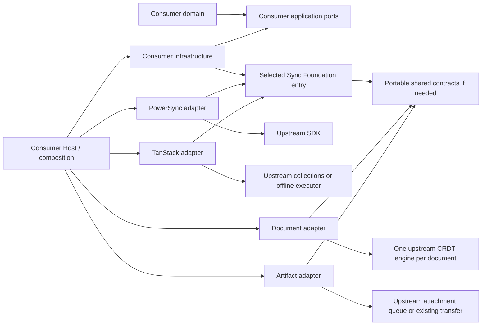

# Sync Foundation: multi-device, multi-database and collaboration library design

Status: proposed design refinement, 2026-11-27. Companion to the
[offline-first foundation plan](offline-first-sync-foundation-plan.md).
Owner direction: architecture must be ready from the first durable feature,
including backend, frontend, web, desktop, mobile and independent hosts.
Prefer one independent library repository, powerful self-hosted open-source
engines, and broad user-data recoverability. No universal multi-master database,
paid dependency, or mass product implementation is authorized by this document.

## 1. Design decision: broad coverage, selective replication

"All useful data is recoverable" is a coverage goal, not "copy every database
table onto every device". Four orthogonal choices per owner-defined data class:

| Axis | Examples |
| --- | --- |
| Custody and authority | Local device, owning Target, authorized shared document, immutable originating execution |
| Concurrency | Single authority/CAS, append with stable IDs, mergeable document, derived/rebuildable |
| Availability | Direct API, durable offline projection/intent, independently writable local data, online-only effect |
| Recovery and sharing | Backup/export, selective replication, artifact transfer, local-only or excluded with reason |

For each meaningful user-authored or irreplaceable data class, explicitly
record a recovery path and a sync eligibility/policy (including "not shared"
and why) in its existing feature design. Include contents, attachments,
relationships, edits, deletions, settings and import/export compatibility;
do not silently omit a field because the first UI does not expose it.
Prefer user-owned eligible workspace data automatically protected by the
chosen backup/sync policy; per-project scope, offline download and retention
are explicit. Default to least privilege for sharing and local copies.
Never replicate credentials, private authorization state, provider secret
material, system files or raw sensitive logs simply to increase coverage.
No universal metadata annotation or executable new coverage gate in P0.

Local save, remote receipt, replicated observation, artifact transfer and
independent recoverable backup are different states. Synchronization is not
backup: deletion and corruption can propagate. An offline device destroyed
before its first backup or replication cannot be recovered by a sync engine.
Expose last confirmed replication/backup, unsent work, missing attachments and
scope completeness. Use independent existing owner backup/restore with tested
recovery, retention and explicit RPO/RTO; do not promise zero loss of data that
has never left the device. Device caches may be disposable only when they
contain no sole copy of user work. Encrypted, user-authorized export of
unsubmitted drafts is a useful recovery path where retention permits it.

## 2. Technology architecture: choose by responsibility, not one winner

Source observations on 2026-11-27; exact release licenses, transitive artifacts,
features and native compatibility need verification in fixtures. An engine's
convergence, documented platform support or marketing scale is not our E2E.

| Candidate | Already provides | Still owned by product / adapter | Decision |
| --- | --- | --- | --- |
| PowerSync Open Edition | Source CDC, selective Sync Streams, SQLite projections, reactive reads, durable FIFO uploads, reconnect/checkpoints, attachment utilities | Source authorization, projection contract, domain writes, receipts/conflicts, device recovery and operational budgets | Primary relational candidate; Apache-2.0 service and SDKs, self-hosted |
| Electric Postgres Sync | Postgres logical replication, HTTP Shapes, partial read-path delivery, fan-out | Write API, durable offline write execution and local persistence selected separately | Strong alternative for projection/large reader fan-out; Postgres only |
| TanStack DB | Reactive normalized collections, live joins, optimistic state, adapters for PowerSync/Electric/API/RxDB, SQLite persistence, offline-transactions | Product intents, storage/leadership and errors, server idempotency, exact offline admission | Optional frontend data layer; also candidate for API-only backend-agnostic profile; 1.0 RC at observation |
| Automerge + Repo | JSON-like CRDT, causal history, document sync protocol, Repo storage/network adapters | Document model, access/retention policy, peer admission, mobile packaging, conflict UX | Primary structured independent document candidate |
| Yjs + Hocuspocus | Text/rich text/editor CRDT, incremental updates, presence, websocket provider/server, persistence/auth hooks | Document scope/current authorization, durable acceptance, format migration, editor binding and semantic publish | Optional collaboration feature; candidate for editor-heavy modules |
| Loro | Structured CRDT including trees, history, version-aware updates, separate transport-agnostic protocol | Application identity/ACL, storage and relay qualification, missing dependencies, history limits | Compare if Automerge misses required tree/move/history semantics |
| RxDB | Reactive local document DB, pluggable replication | Custom backend checkpoint/conflict protocol, exact free storage/runtime eligibility | Reconsider only with a viable fully OSS storage profile; some storage plugins commercial |
| CouchDB + PouchDB | Replication protocol, revisions, conflicts, local/browser DB, peer sync | Domain conflict resolution, security scope, migration to document model, native support | Good independent document database alternative, not default for relational products |
| WatermelonDB | SQLite client DB, offline change tracking, pull/push client protocol | Consistent server delta/checkpoints, deletion/change history, permissions, client-wins semantics | Mobile-oriented fallback, larger backend work; not the default |
| Replicache / Zero | Replicache optimistic offline framework; Zero reactive query sync | Replicache maintenance mode; Zero offline-write gap under earlier study; verify current guarantees if revisited | Not preferred for greenfield long-offline use |
| LiveStore / Evolu | Alternative local-first/event-oriented or encrypted relay models | New canonical event/identity/storage semantics, access and effect boundaries | Future product-specific comparison, no adoption or rewrite here |

These are complementary categories: a client query layer is not a replication
service; a CRDT is not a business database, a queue is not an execution
authority, and a blob transfer mechanism is not an editor protocol.
Do not install every row of this table or wrap it behind one lowest-common-
denominator engine interface.

### Current source notes

- [PowerSync open source](https://powersync.com/open-source) and
  [licensing](https://powersync.com/legal/licensing-terms): core service/SDK
  Apache-2.0, optional closed commercial features excluded. Historic FSL
  artifacts need exact license checks.
- [PowerSync source/platform overview](https://github.com/powersync-ja):
  Postgres, MongoDB, MySQL, SQL Server, Azure DocumentDB (alpha per
  [edition matrix](https://powersync.com/pricing)); experimental Convex.
  The [Terraform source guide](https://registry.terraform.io/providers/powersync-ja/powersync/latest/docs/guides/connecting-source-database)
  describes one source connection per instance and labels MySQL/SQL Server beta.
  Do not infer equal maturity/availability across every DB and Open Edition.
  P1 qualifies PostgreSQL only. Separate source adapters can be added after
  actual demand. No SQLite-source or bidirectional PG-to-PG guarantee.
- [PowerSync write path, November 19](https://releases.powersync.com/announcements/write-path-guides-and-a-reference-write-implementation):
  ready connector and reference server exist. Reuse connector mechanics
  where compatible; do not install its generic direct SQL mutation endpoint
  for domain-controlled aggregates. Use the owning API, not client CRUD
  authorization or database write credentials. See also
  [conflict semantics](https://github.com/powersync-ja/powersync-docs/blob/main/handling-writes/handling-update-conflicts.mdx)
  and [checkpoint requests](https://powersync.com/blog/checkpoint-requests-client-synced-now).
- [PowerSync attachment utilities](https://releases.powersync.com/announcements/improved-attachment-utilities-in-the-javascript-sdks):
  JS SDKs already provide local/remote storage adapters and upload/download
  queue. Reuse behind artifact ports when appropriate, preserving existing
  artifact authority and hash/manifest verification.
- [PowerSync Web SDK](https://powersync-ja.github.io/powersync-js/web-sdk/globals):
  automatic VFS may fall back to in-memory without OPFS; multi-tab and Safari
  behavior differ. Explicit durable storage qualification, not silent fallback
  for offline commitments. [Tauri SDK](https://releases.powersync.com/announcements/introducing-the-powersync-tauri-sdk-alpha)
  announced alpha and documents WebView storage loss across upgrades.
- [Electric Postgres Sync](https://electric.ax/sync/postgres-sync):
  read path via Shapes; backend API writes. [TanStack DB integration](https://tanstack.com/db/latest/docs/collections/electric-collection)
  can await observed transaction ID; not itself server receipt durability.
- [TanStack DB installation](https://tanstack.com/db/latest/docs/installation),
  [offline transactions](https://tanstack.com/db/latest/docs/guides/offline-transactions),
  [SQLite persistence](https://tanstack.com/db/latest/docs/guides/sqlite-persistence)
  and [current RC](https://tanstack.com/db/latest): ready collections,
  storage/queue pieces for multiple runtimes; SQLite collection persistence
  and pending outbox have distinct owners. Web fallback to online-only on
  missing durable storage/non-leader and React Native custom storage are
  explicit behaviors to qualify, not guarantees of offline saves from all tabs.
- [Automerge Repo](https://automerge.org/docs/reference/repositories/),
  [storage](https://automerge.org/docs/reference/repositories/storage/) and
  [network sync](https://automerge.org/docs/tutorial/network-sync/):
  built-in IndexedDB, Node filesystem and WebSocket adapters; no production
  reliance on public demo relay. Use actual upstream sync protocol.
- [Yjs](https://github.com/yjs/yjs), [offline support](https://docs.yjs.dev/getting-started/allowing-offline-editing),
  [Hocuspocus MIT server](https://github.com/ueberdosis/hocuspocus),
  [persistence](https://tiptap.dev/docs/hocuspocus/guides/persistence)
  and [authentication](https://tiptap.dev/docs/hocuspocus/guides/authentication):
  reuse open components rather than paid collaboration cloud or hand-written
  socket protocol. Official browser persistence; community RN/provider ports
  require separate qualification. Persist CRDT binary updates/state, not
  reconstituted JSON that changes document identities. Debounced persistence
  is not a durable ACK; prove crash/restore or explicitly distinguish live
  peer delivery from persistence.
- [Loro sync](https://www.loro.dev/docs/tutorial/sync) and
  [protocol](https://github.com/loro-dev/protocol): document-specific causal
  operations; convergence alone cannot detect all hidden/semantic conflicts.
- [CouchDB conflict model](https://docs.couchdb.org/en/latest/replication/conflicts.html),
  [PouchDB](https://pouchdb.apache.org/guides/replication.html),
  [WatermelonDB](https://watermelondb.dev/docs/Sync/Backend),
  [Replicache status](https://replicache.dev/) and
  [Evolu protocol](https://www.evolu.dev/docs/api-reference/common/local-first/Protocol).
  Alternatives retain their own data models and constraints.

## 3. Supported profiles, database and device matrix

| Profile | Server/source | Client storage | Write and availability |
| --- | --- | --- | --- |
| Local direct | Orchestrator bundled native PostgreSQL; other product-owned DB | No duplicate DB required; local Host API | Full owned local commands; optional local model |
| Relational sync | PowerSync + one supported source/instance | Native SQLite / qualified Web WASM persistence | Durable approved intents through owning API, server authority |
| Postgres read sync | Electric + existing PostgreSQL | TanStack DB or appropriate local adapter | API; qualify separate durable mutation path if needed |
| API-only offline | Any owning backend (PG, SQLite, MySQL, document/file, Go/TS etc.) | TanStack DB persistence + offline-transactions or proven owner store | Existing API and stable intents; projection refresh, no automatic CDC guarantee |
| Documents | Owner-approved relay or admitted peer network | Automerge Repo / Yjs provider persistent state | Concurrent local edits within scope; explicit publish/validation |
| Instance transfer | Any pair of independent Targets | Their own authoritative stores | Owner logical records, immutable facts, selective artifact transfer; no DB mirroring |

API-only mode is a useful portability fallback, not a claim of efficient full
incremental sync for any database. Start with bounded versioned authorized
snapshots/queries and intents. Only add delta/checkpoint mechanisms if a real
use case needs them and an established engine or existing owner feed can
supply the contract. Avoid creating a new generic CDC engine or a redundant
PostgreSQL shadow for every other database. No transparent DB switching:
logical schema, types/precision, ordering, ID mapping, transactional
capability and migration need owner-specific conformance. Do not expose
PostgreSQL replication slots or NATS topics to untrusted clients.

| Environment | Preferred connection and storage | Required evidence |
| --- | --- | --- |
| Electron fully local | Public loopback local Host; bundled PostgreSQL remains authority | Cold offline startup, actual local execution, restart/backup |
| Electron hosted client | Node/native PowerSync via protected main/IPC or qualified browser path | Native module packing, upgrades, multi-window, no SQL credentials in renderer |
| Web/PWA | PowerSync Web or API/TanStack; durable IndexedDB/OPFS as qualified | App shell offline cold reload, storage quota/eviction, private mode refusal, Safari/Chromium/Firefox matrix, multi-tab leadership |
| React Native / Expo | Native SQLite SDK; optional TanStack; editor-specific adapter | Device suspend/kill/relaunch, migration, permissions, network flaps, no background-sync assumption |
| Native iOS/Android or Flutter | Upstream Swift/Kotlin/Dart SDKs where suitable | Exact SDK, storage and protocol conformance; no dependence on TS runtime |
| Node/headless/agent | Native Node adapter or direct owning API | Explicit local data scope, resource limits, shutdown/restart |
| Tauri / Capacitor / future | Upstream adapter if stable and fit | Actual installed binary/update path; alpha is not production support |

Portability means common logical contracts and semantically compatible
implementations, not JavaScript in every process. Go and future native
consumers should reuse existing public API/versioned schema and upstream
SDKs. No cross-language transpilation program or new public wire format
until concrete need. Platform-neutral types must not import DOM, Node,
React, Electron, SQL drivers or framework runtime.

## 4. Repository and package topology

Owner now favors an independent repository early. Proposed repository:
`agent-teams-ai/sync-foundation`. Create a documentation/admission bootstrap
when the organization repository-creation capability and required Foundation
bootstrap route are available; this does not admit production packages.
Use existing [organization vision](ecosystem-vision.md), repository admission,
FMS, applicable CMS, engineering tooling and version catalog. Default proposed
license Apache-2.0 subject to owner/license check. No runtime dependency on
engineering-foundation. No publication prerequisite for fixture development:
consume exact local/packed artifacts or reviewed immutable source revisions
through the existing library-first route, not git main floating dependencies.

Illustrative logical source layout (materialize entries only when P1 proves
their responsibilities; names/package namespace not public commitments):

```
sync-foundation/
  docs/                 # design, decisions, profiles, qualification, source evidence
  packages/
    core/               # portable common lifecycle/status/receipt semantics if proven
    server/             # host-neutral integration helpers; domain callbacks injected
    client/             # headless client integration; no React or SQL dependencies
    adapters/
      powersync/        # independent server, web, node, native entries as needed
      tanstack/         # optional collections/API offline adapter
      automerge/        # optional structured document sync
      yjs/              # optional collaborative editing + Hocuspocus integration
      electric/         # alternative relational read path, only if needed
      attachments/      # optional upstream queue/blob adapter, not new protocol
    testing/            # development-only conformance
  fixtures/             # independently composed representative test hosts
```

The physical FMS package layout must follow the actual admission profile;
the nested tree illustrates ownership, not an exemption from repository
package/dependency policy. Start small: P1 fixture and one actual adapter;
P2 extracts proven core/client/server slices and packages. No empty package
scaffolds or runtime imports just for symmetry.



Compile-time rule: an arrow means dependency, not ownership transfer. In this
illustration domain/application are consumer-owned; domain must not import
application ports. The CD-to-CP arrow is semantic use-case direction only,
and the application imports its own domain. All concrete adapters import
only appropriate narrow contracts and the selected upstream library. No
adapter imports unrelated engine packages. GM may wire factories at the
outer Host; core must remain independently usable with plain composition.
Browser import must not transitively load node/native drivers; server import
must not pull React or Electron. Release and conformance only after
independent hosts exercise identical semantic laws with selected backends.

### Prefer semantic ports, not a giant engine facade

- Consumer-owned query/watch port for a feature's typed read model,
  including stale/partial/ready/error status; do not hide live queries or
  require translating arbitrary SQL into a custom universal DSL.
- Consumer-owned command/intent port with explicit local admission,
  durability, receipt and conflict outcome. Existing API remains the write
  authority. Stable operation identity, version and scope from actual owner
  contracts; no generic row-to-aggregate mapping.
- Optional feature-owned document session port: open by stable authorized
  document identity, snapshot/watch, explicit edit/transaction and publish
  semantics. Advanced editor bindings can use upstream engine types in the
  editor infrastructure; do not flatten rich CRDT operations into
  generic JSON patches.
- Artifact port: manifest/ref, local availability, staged/verified transfer,
  status, retry and cleanup. Reuse owner blob/transfer API and upstream
  attachment queue; never store large blobs in relational replication rows.
- Operational lifecycle: start/stop/account switch/recovery and inspect
  capability-specific status. Host owns generation and credential lifecycle;
  library does not own app authorization, product state or process placement.

Prefer small feature-specific interfaces. Share mechanically identical
types/adapter logic after conformance demonstrates reuse; avoid a common
schema that requires all apps to serialize their business model identically.
Use discriminated capabilities at composition (direct, relational projection,
durable intent, document, attachments), not dynamic global service locator
or implicit runtime engine selection. Vendor adapters expose enough
capability to exploit native mechanisms, while product core remains free of
vendor types. Upgrading/swapping engines requires explicit storage/queue
migration, quiesce/drain or retained work, mixed-version/recovery tests and
rollback. Switching Automerge/Yjs is a document-format migration, never
a configuration-only hot swap. Retain stable document/operation IDs and
recovery receipts across module update; LMU does not provide data migration.

## 5. Integration flows and reuse rules

### Relational profile: use PowerSync's machinery

Read: owning DB -> owner-approved versioned projection relation -> PowerSync
CDC/Sync Stream with authorized scopes -> client SQLite -> feature query.
A DB view is not assumed to be a supported CDC source; choose publication-
eligible tables/projection mechanism and verify least-privilege scope. If an
explicit projection is maintained asynchronously, expose watermark/lag and
consistency guarantees; never introduce another mutation authority.

Write: feature command -> uploadable stable intent and durable local overlay ->
SDK FIFO queue -> connector -> actual owning API -> current authorization +
domain invariants + transaction/receipt/outbox -> explicit result -> queue
settlement -> replicated observation/checkpoint. Use upstream .complete and
checkpoint correctly. Queue draining is not "everything executed"; a receipt
is distinct from read-your-write observation. Permanent business conflict or
denial must be durably visible and allow other independent work to proceed;
temporary or unknown outcome retries same identity. Bind multi-row operations
to actual aggregate transaction or explicit independent receipts. No direct
PowerSync reference CRUD endpoint for protected product state.

Use direct native PowerSync reactive queries first. Compare optional TanStack
collections for complex views and existing React/Vue ecosystems; it must
consume PowerSync as one storage/sync owner. Do not add TanStack offline-
transactions for the same write path or persist the same full rows twice.
For API-only profile, TanStack's executor is a candidate sole pending-write
owner; require durable leadership/non-leader behavior and explicit local save
evidence. Do not let upstream online fallback report successful offline
persistence. Use actual APIs, not hardcoded current-implementation assumptions
in portable contracts. P1 comparison can reject TanStack if direct SDK
provides adequate headless views and lower total complexity.

### Collaboration profile: independent optional feature

Example: a user edits prompt Markdown on desktop offline, a teammate edits
on web; both rejoin and converge. Add editor-specific Yjs + Hocuspocus
candidate with native upstream editor binding, authenticated document room,
storage and presence. Automerge Repo suits JSON-like independently authored
structured documents (e.g. planning notes, workflow draft). Both need stable
owner document IDs, scoped access and explicit retention/delete policy.
Choose exactly one authoritative CRDT representation per document; no dual
mutable JSON/CRDT/relational copies. Relational replication may carry document
metadata or an owner-approved derived summary, not a second mutation channel.
Transport one update stream through one admitted mechanism; use the upstream
network protocol, not repeated whole-document snapshots over generic row
sync. Keep cursors/presence ephemeral. Define document publish boundary:
a collaboratively edited draft never changes active agent instructions,
deployments, grants or workflow execution until authorized application
command validates and pins the selected document revision. Running agents
retain admitted behavior versions. Authorization at room admission and current
receiver decisions must reject stale/revoked peer writes; an open socket is
not perpetual authority. Malformed/oversized updates and denial-of-service
budgets, server crash before persistence, reconnect with expired grants,
history compaction and explicit deletion need real tests.
Text editing is an optional module, not a prerequisite for ordinary notes.

### Artifacts and independent Targets

Use upstream attachment helpers where they fit, with local/remote storage
ports and existing product manifest/hash APIs. No full filesystem mirroring.
An accepted metadata row does not prove referenced blob availability.
Verify upload, digest, size, permissions and atomic publication; crash between
blob and metadata yields explicit resumable or orphaned state, not a phantom
completed result. User sees partial project downloads and pending files.
Artifact queue owns file transfer only; no duplicate row-command queue.
Independent Targets transfer selected versioned records with original IDs,
provenance and idempotent import receipt. Neither PowerSync nor Electric
makes local and hosted PostgreSQL independent multi-writers for the same
authoritative task. The owner must admit shared/federated scope separately.

## 6. Fixture-first acceptance and sizing refinement

| Slice | Production LOC | Test LOC | Complexity / reliability target / confidence |
| --- | ---: | ---: | --- |
| A: P1 relational fixture and direct PowerSync adapters | 600-1,100 | 700-1,300 | 6 / 8 / 7 |
| B: P2 shared extraction and second independent composition | 350-850 | 500-1,000 | 7 / 8 / 6 |
| C: optional TanStack view adapter on PowerSync (only if useful) | 100-300 | 150-400 | 4 / 8 / 7 |
| D: optional API-only TanStack offline profile, alternate backend fixture | 300-700 | 400-900 | 6 / 8 / 6 |
| E: P3 structured Automerge document | 350-750 | 450-1,000 | 7 / 8 / 6 |
| F: optional Yjs/editor collaboration module | 350-850 | 500-1,000 | 7 / 8 / 6 |
| G: optional attachment integration (reuse helper and existing artifact ports) | 200-500 | 350-700 | 6 / 8 / 6 |
| H: P4 first narrow real product integration | 350-900 | 400-900 | 7 / 8 / 6 |

A+B: 950-1,950 production and 1,200-2,300 test LOC (same original P1/P2
baseline; no double-count). All illustrative A-H combined: 2,600-5,950
production, 3,450-7,200 test LOC, not a scope commitment; includes overlapping
alternative candidate profiles at upper planning breadth. C/D may share real
adapter code and reduce size, or be unnecessary. E/F may be alternatives.
No estimates include full native app/platform qualification, product-specific
migration, distributed execution, federation/E2EE, or general scale claims.
Scores are assumptions/targets, not measured reliability. Start A+B only
after repository admission/explicit scope; don't materialize unused modules.

P1 tests one note/template metadata slice on actual self-hosted PowerSync +
Postgres, real Node backend and Chromium client. Compare SDK-native query
path with optional TanStack view in same bounded scenario; no benchmark
claims without same corpus/hardware/pins. P2 second independently wired Host
must consume installed library artifact and exercise independent product
semantics; if API-only profile becomes necessary select one existing SQLite
backend fixture rather than pretend PowerSync syncs arbitrary sources.
Additional device-specific tests require real native hosts, not browser emulation.

Acceptance discriminator examples beyond main plan:
1. Disable WAN, edit/create local draft, crash before/after durable queue
   admission and remote commit, reload, duplicate replay; explicit status and
   no lost admitted change. Reject web memory fallback as durable.
2. Desktop and browser clients against same self-hosted authority, selective
   project access; edits/receipts converge and forbidden project not received.
   Mobile installed profile later runs equivalent suspension/restart case.
3. Source database/backend is swapped only in the API-only alternate fixture:
   same feature-owned port/receipt laws, no dependency from domain to SQL,
   no promise of equivalent CDC performance. Test type/version incompatibility.
4. Queue-only upload accepted but replica not yet observed; UI distinguishes
   pending/accepted/observed. Delete/stale grant/rejected conflict and restart
   never lose authorized user content or replay a forbidden effect.
5. Optional editor: two offline peers, concurrent text edits, upstream
   document state equality after reconnect, server kill before persistence,
   revoked writer, pinned published revision and running agent unaffected.
6. Optional attachment: upload/download while disconnected, partial upload,
   wrong hash, deletion, account switch, reconnect and verify actual bytes.
7. Module/SDK upgrade: retain durable work across restart, old/new schema,
   unsupported migration refusal/recovery export; no silent cache reset.
8. Backup restore independently of replica (including data excluded from
   sync); simulated local disk loss before and after confirmed backup;
   accurate RPO/status and stale device/receipt epoch fencing.

Scale gates quantify source CDC lag/WAL or binlog retention, service storage,
fan-out and subscription count, client disk/memory, attachment bandwidth,
outbox growth, large datasets and CRDT history. Backpressure and scope
limits are required for the selected profile. No benchmark has run here.

## 7. Review findings and next action

Self-review passes of this refinement (not independent approval):
- Multi-source claims checked against upstream one-source configuration:
  no generic PG-to-PG or SQLite-source promise, beta/alpha separated.
- Platform durability: automatic Web VFS can be transient, multi-tab leader
  and mobile background limitations explicit. No optimistic UI = saved claim.
- DRY: native PowerSync queue/queries/checkpoints, TanStack optional; reuse
  actual attachment queue and Hocuspocus. Separate editor/structured docs and
  reject second representation or duplicate queues.
- Authority and recovery: broad recovery classification instead of replicating
  secrets, separate sync/backup/transfer; current receiver permission,
  explicit draft publication, irreversible effects unchanged.
- Scope and costs: repository bootstrap is documentation/admission, no
  speculative runtime core or seven empty packages; A+B size preserved,
  remaining adapters and native profiles optional.

Next concrete action: initialize the independent repository via the approved
organization admission route; link this exact reviewed proposal and parent
PR, keep only one canonical source of policy and library design. This PR
can be reviewed before repository exists. Separate repo takes ownership of
detailed library plan/evidence on adoption; organization guide links it
rather than duplicating it. Product owners incorporate readiness in their
existing feature decisions now without waiting for library implementation.
No creation of repository, runtime code, E2E, release, merge or independent
approval is claimed in this design refinement.
